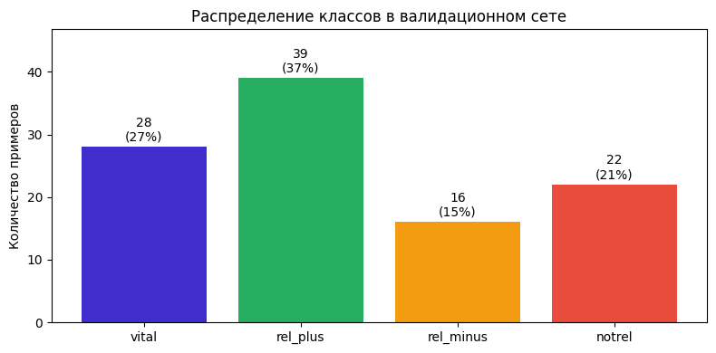
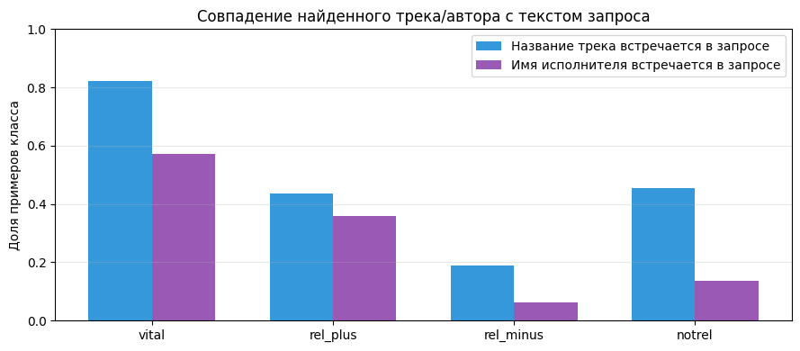

# Music Search Relevance Prompt (GigaChat-Pro)

[Русская версия](README.md)

A prompt engineering test assignment (May 2026). GigaChat-Pro has to judge how well a found track matches a music service user's query, the way human assessors used to. There are four labels, from `vital` ("exactly what I was looking for") through `rel_plus` and `rel_minus` to `notrel` ("not it").

## What was done

- **Validation set analysis** (105 examples):
  - class distribution and query length;
  - how often the track title and the artist name appear in the query itself. The track title is in the query for 82% of `vital` examples and 19% of `rel_minus`.
- **Prompt.** A system prompt with criteria for each label, a collision checklist (a single shared word with a different meaning) and extended `rel_plus` criteria. The user prompt holds the query, the track and the artist, and exactly one label is expected in return.
- **Generation** with `langchain-gigachat` at temperature 0 and max_tokens 10, with the model answer normalized to one of the four labels.
- **Metrics:** accuracy, macro F1 (the main one because of class imbalance), weighted F1, a per-class report and a confusion matrix.

<table>
  <tr>
    <td></td>
    <td></td>
  </tr>
  <tr>
    <td align="center">Class distribution in the validation set</td>
    <td align="center">Share of examples where the track title or the artist appears in the query</td>
  </tr>
</table>

Plot labels are in Russian, as in the original notebook.

## Results

| Approach | Macro F1 |
|---|---|
| Baseline prompt with four criteria | 0.568 |
| **Collision checklist and extended `rel_plus` criteria (final)** | **0.613** |
| Chain-of-Thought (reasoning before the label) | 0.521 |
| Self-consistency (T = 0.3, n = 5, majority vote) | 0.568 |
| Two-stage classification (binary, then refinement) | 0.590 |

The final prompt reaches accuracy 0.686, macro F1 0.613 and weighted F1 0.664.

The model is strongest on `vital`, `rel_plus` and `notrel`, with F1 from 0.59 to 0.88. The weak spot is `rel_minus` (F1 0.27): the model misses that a query means a well-known artist when the search returned a little-known track with the same title.

CoT and self-consistency did not help: reasoning amplifies systematic errors, and GigaChat-Pro answers identically at different temperatures.

## Quick start

```bash
pip install -r requirements.txt
export GIGACHAT_CREDENTIALS="your GigaChat API authorization key"
jupyter notebook gigachat_pe_test.ipynb
```

Put `valid_set.tsv` next to the notebook: the dataset itself is not part of the repository.

## Tech stack

Python, LangChain (`langchain-gigachat`), GigaChat-Pro, pandas, scikit-learn, Matplotlib.

## License

[MIT](LICENSE)

---

<sub>The code was written in May 2026 and published on GitHub in November 2026. Commit dates follow the dates of the original files; the README and figures were added at publication.</sub>
