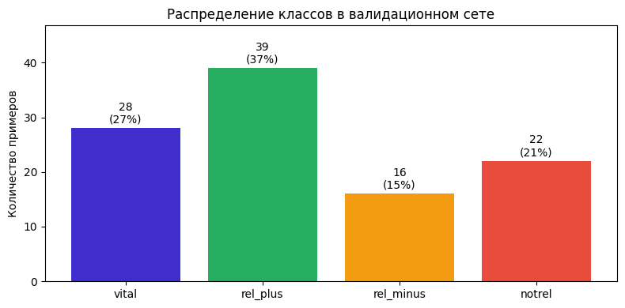
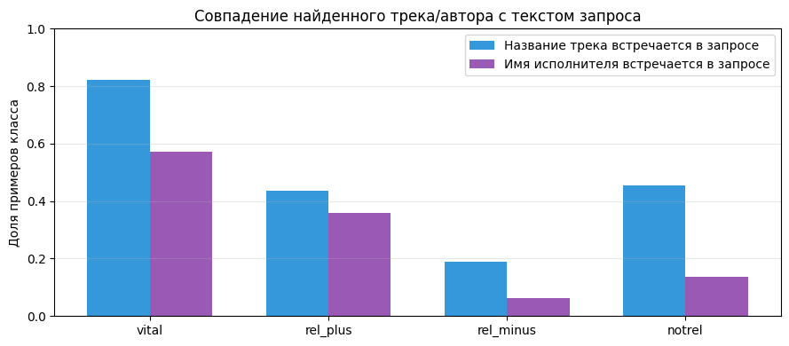

# Промпт для оценки релевантности музыкальной выдачи (GigaChat-Pro)

[English version](README.en.md)

Тестовое задание на промпт-инженера (май 2026). GigaChat-Pro должен оценивать, насколько найденный трек соответствует запросу пользователя музыкального сервиса, так же, как это делали эксперты-разметчики. Меток четыре: от `vital` («нашли именно то, что искали») через `rel_plus` и `rel_minus` до `notrel` («не то»).

## Что сделано

- **Анализ валидационного набора** (105 примеров):
  - распределение классов и длина запросов;
  - как часто название трека и имя исполнителя встречаются в самом запросе. Название трека есть в запросе у 82 % примеров `vital` и у 19 % `rel_minus`.
- **Промпт.** Системный промпт с критериями для каждой метки, чек-листом на коллизии (совпадение по одному слову при другом смысле) и расширенными критериями `rel_plus`. Пользовательский промпт содержит запрос, трек и исполнителя, в ответ ожидается ровно одна метка.
- **Генерация** через `langchain-gigachat` с temperature 0 и max_tokens 10, ответ модели приводится к одной из четырёх меток.
- **Метрики:** accuracy, macro F1 (основная из-за дисбаланса классов), weighted F1, отчёт по классам и матрица ошибок.

<table>
  <tr>
    <td></td>
    <td></td>
  </tr>
  <tr>
    <td align="center">Распределение классов в валидационном наборе</td>
    <td align="center">Доля примеров, где название трека или имя исполнителя есть в запросе</td>
  </tr>
</table>

## Результаты

| Подход | Macro F1 |
|---|---|
| Базовый промпт с четырьмя критериями | 0,568 |
| **Чек-лист на коллизии и расширенные критерии `rel_plus` (финальный)** | **0,613** |
| Chain-of-Thought (рассуждение перед меткой) | 0,521 |
| Self-consistency (T = 0,3, n = 5, голосование) | 0,568 |
| Двухстадийная классификация (бинарная, затем уточнение) | 0,590 |

Финальный промпт даёт accuracy 0,686, macro F1 0,613 и weighted F1 0,664.

Сильнее всего модель работает на `vital`, `rel_plus` и `notrel`: F1 по ним от 0,59 до 0,88. Слабое место `rel_minus` (F1 0,27): модель не узнаёт, что запрос подразумевает известного артиста, если в выдаче нашёлся малоизвестный одноимённый трек.

CoT и self-consistency не помогли: рассуждение усиливает систематические ошибки, а GigaChat-Pro отвечает одинаково при разной температуре.

## Запуск

```bash
pip install -r requirements.txt
export GIGACHAT_CREDENTIALS="ключ авторизации GigaChat API"
jupyter notebook gigachat_pe_test.ipynb
```

Положите `valid_set.tsv` рядом с ноутбуком: сам набор в репозиторий не входит.

## Стек

Python, LangChain (`langchain-gigachat`), GigaChat-Pro, pandas, scikit-learn, Matplotlib.

## Лицензия

[MIT](LICENSE)

---

<sub>Код написан в мае 2026, на GitHub выложен в ноябре 2026. Даты коммитов взяты по датам исходных файлов, README и иллюстрации добавлены при выгрузке.</sub>
